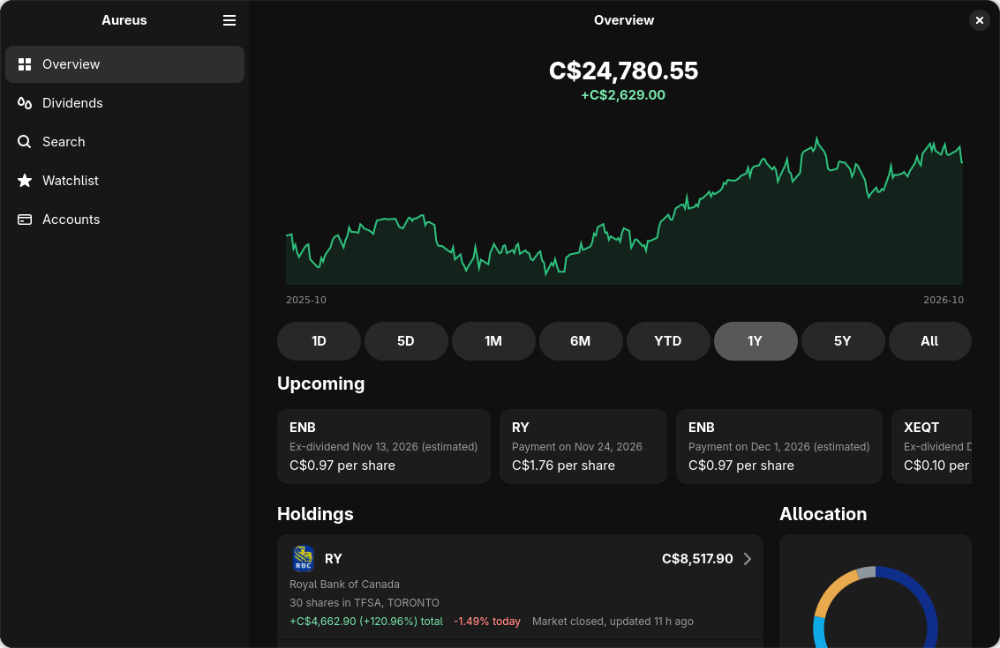
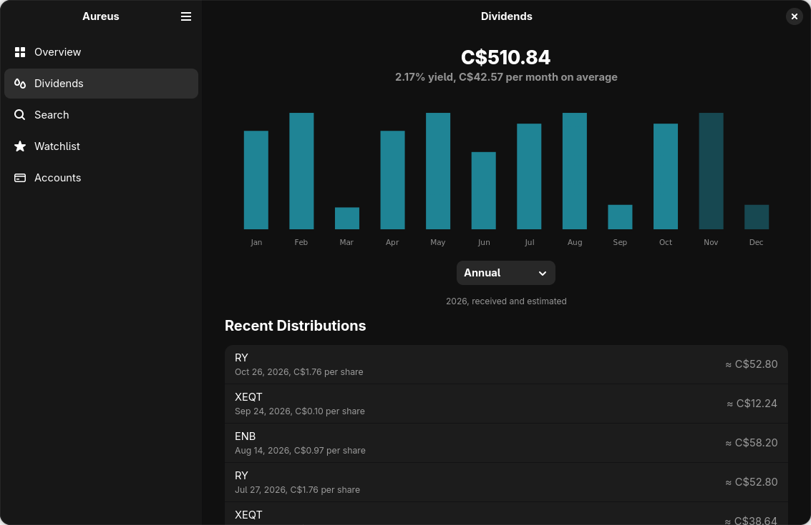
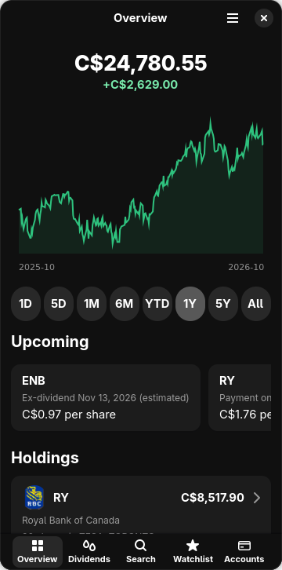
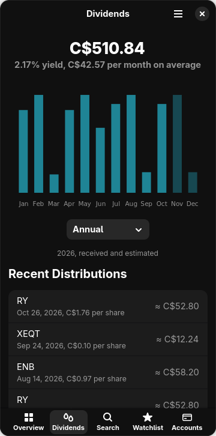

# Aureus

A native portfolio tracker for Linux desktop and mobile devices. Aureus is
written in Rust with GTK4 and libadwaita, keeps your portfolio in a local
SQLite database, and uses one adaptive interface for both desktop and phone
layouts.

> **Aureus is for personal portfolio tracking.** It does not provide
> financial, investment, tax or legal advice.

> **Note:** AI tools were used in developing this project.

## Features

- **Accounts and activity:** multiple accounts, each in its own native
  currency, with trades, cash activity, transfers between accounts and
  splits. Positions are derived from recorded activity.
- **Portfolio:** value and history in a selectable Portfolio Currency, using
  historical exchange rates for past performance.
- **Market data:** live quotes, charts, search, a watchlist and dividend
  history from Yahoo Finance.
- **Brand logos:** stock logos from Elbstream, which can be turned off in
  Preferences.
- **Reports and backups:** PDF report export and portable backup and restore.
- **Platform:** Linux, packaged as a Flatpak. Windows and macOS builds are
  experimental.

### Supported currencies

CAD, USD, EUR, GBP, JPY, AUD, CHF, CNY, HKD, INR, IDR, KRW, MYR, MXN, NZD,
NOK, PEN, PLN, SGD, ZAR, SEK, TWD, THB, TRY, BRL.

## Screenshots

<div align="center">
  

  

  <br />

  
  &nbsp;&nbsp;
  
</div>

## How it works

1. **Storage.** Accounts, transactions, cash activity and corporate actions
   are stored locally in SQLite. Changing the Portfolio Currency only changes
   presentation; stored amounts and account currencies are never rewritten.
2. **Market data.** Quotes, price history, search, dividends and splits come
   from Yahoo Finance. Quotes are requested live; cached values are only an
   offline fallback.
3. **Exchange rates.** Current rates come from Yahoo Finance with Bank of
   Canada as a fallback. Historical rates use Bank of Canada observations,
   with Yahoo Finance filling gaps.

## Building and running

You need Flatpak and `flatpak-builder` with the Flathub remote configured. The
build uses the GNOME 50 runtime and SDK.

```bash
git clone https://github.com/Mars7x/Aureus.git
cd Aureus
./build-flatpak.sh
```

[GNOME Builder](https://apps.gnome.org/Builder/) can also build and run the
project from the manifest in `flatpak/`. For development outside Flatpak you
need Rust 1.92 or newer and the GTK4 and libadwaita development packages:

```bash
cargo run
cargo test
```

### Windows

Windows builds are experimental. Each release includes a zip: extract it and
run `bin\aureus.exe`. To build it yourself, install
[MSYS2](https://www.msys2.org/) and, in a UCRT64 shell, run:

```bash
pacman -S --needed zip mingw-w64-ucrt-x86_64-{gcc,pkgconf,rust,gtk4,libadwaita,librsvg,adwaita-icon-theme}
cargo build --release --locked
scripts/package-windows.sh Aureus-windows-x86_64
```

### macOS

macOS builds are experimental. Each release includes zips for Apple Silicon
(arm64) and Intel (x86_64): extract it and move `Aureus.app` to Applications.
Aureus is not notarized, so the first time you open it, Control-click the app
and choose Open. To build it yourself with [Homebrew](https://brew.sh/):

```bash
brew install gtk4 libadwaita librsvg adwaita-icon-theme hicolor-icon-theme dylibbundler pkgconf
cargo build --release --locked
scripts/package-macos.sh Aureus-macos
```

### Releases

Publishing a GitHub release builds the Flatpak bundles (x86_64 and aarch64),
the Windows zip and the macOS zips, and attaches them to the release.

## Documentation

- [Project context](docs/AUREUS_PROJECT_CONTEXT.md)
- [Development history](docs/AUREUS_DEVELOPMENT_HISTORY.md)

## Legal

This is an independent project, not affiliated with or endorsed by Yahoo,
the Bank of Canada or Elbstream. Market data and exchange rates are provided
by their respective sources and may be delayed or incomplete. Brand logos are
provided by [Elbstream](https://elbstream.com) and remain trademarks of their
owners.

Licensed under GPL-3.0-or-later. See [LICENSE](LICENSE).
